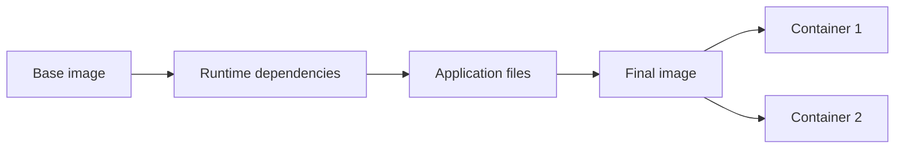
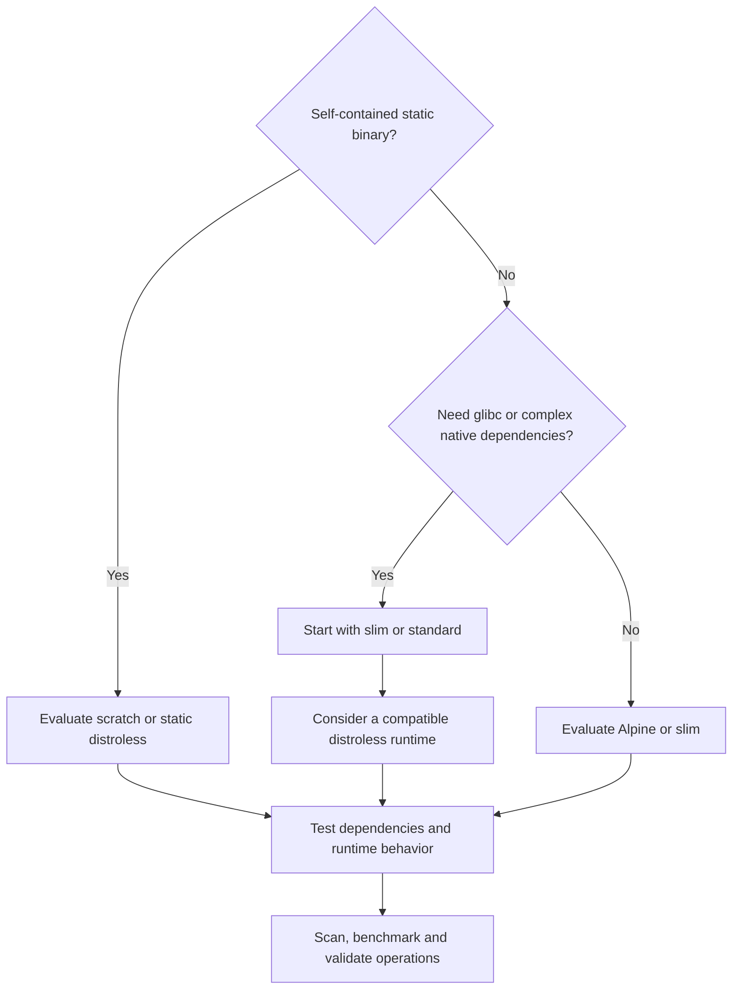

# Docker Images: Types, Differences and When to Use Them

Choosing a base image is an engineering decision, not just a competition to produce the smallest image. The right choice depends on runtime dependencies, compatibility, security, maintenance and troubleshooting needs.

This page covers:

1. What a Docker image contains
2. Common image variants and their differences
3. Practical Dockerfile examples
4. Multi-stage builds and image selection
5. Security, inspection and troubleshooting
6. A production readiness checklist

> Tags, supported architectures and image contents change over time. Examples are illustrative; confirm the current supported tags and test them before production use.

---

## 1. What is a Docker image?

A container image is a packaged filesystem and configuration used to create containers. It contains application files, dependencies and metadata such as the default command. Images are composed of filesystem layers; containers add a writable layer on top of the image. Linux containers share the host's Linux kernel (or the kernel of a Linux VM on platforms such as Docker Desktop).

Think of an image as a packaged recipe with ingredients already prepared, and a container as a running instance of that package. Multiple containers can start from the same image.

- **Base image:** the starting point selected with `FROM` in a Dockerfile.
- **Runtime image:** the final image used to run the application.
- **Tag:** a human-readable reference, such as `python:3.12-slim`; tags can change.
- **Digest:** a content-addressed reference that identifies a specific image manifest or image index.



---

## 2. Common image variants

These are practical categories, not mutually exclusive formal Docker image types. For example, an official Python image can also be Alpine-based.

| Variant | What it contains | Best suited for | Trade-off |
|---|---|---|---|
| Standard | Distribution or language runtime with common libraries and utilities | Compatibility, development, complex dependencies | More packages and potentially larger footprint |
| Slim | Reduced distribution or runtime package set | General-purpose production workloads | Some tools and libraries must be added explicitly |
| Alpine | Minimal Alpine Linux userspace, typically musl libc and BusyBox | Workloads tested against musl | Native dependency compatibility and build complexity |
| Distroless | Application runtime and essential dependencies | Controlled production runtimes | Usually no shell or package manager |
| Scratch | Empty starting filesystem | Self-contained binaries | All required runtime files must be supplied |
| Debug | Runtime variant or separate image with diagnostic tools | Controlled troubleshooting | Extra tools and potentially greater attack surface |

### Standard images

Examples: `ubuntu:24.04`, `python:3.12`.

Use a standard image when native dependencies, common utilities or broad compatibility matter. A language runtime image already includes the language; an OS image generally requires you to install it.

```dockerfile
FROM python:3.12
WORKDIR /app
COPY requirements.txt .
RUN pip install --no-cache-dir -r requirements.txt
COPY app.py .
CMD ["python", "app.py"]
```

### Slim images

Example: `python:3.12-slim`.

Slim variants remove many packages from the standard image. They are a useful starting point for Python applications that rely on glibc-compatible dependencies (glibc is a common Linux C library).

```dockerfile
FROM python:3.12-slim
WORKDIR /app
COPY requirements.txt .
RUN pip install --no-cache-dir -r requirements.txt
COPY app.py .
CMD ["python", "app.py"]
```

If a dependency needs a compiler or system headers, install build dependencies in a builder stage rather than keeping them in the final runtime image. Required shared libraries still belong in the runtime image.

### Alpine images

Examples: `alpine:3.22`, `python:3.12-alpine`.

Alpine uses musl instead of glibc and the `apk` package manager. BusyBox provides many common command-line utilities. Both musl and glibc implement the C standard library, but dynamically linked binaries built for one may not run against the other. Pure Python code is generally unaffected directly; native extensions and their dependencies need compatibility checks.

```dockerfile
FROM python:3.12-alpine
WORKDIR /app
COPY requirements.txt .
RUN pip install --no-cache-dir -r requirements.txt
COPY app.py .
CMD ["python", "app.py"]
```

**Watch for:** native extensions, unavailable musllinux wheels, binaries built for glibc and differences in shell utilities. A smaller base can lead to a larger or slower build if dependencies must be compiled. Benchmark the final application image, not just the base.

### Distroless images

Distroless images contain selected runtime dependencies without a conventional shell or package manager in their normal variants. Different variants exist for static binaries, C libraries and language runtimes.

Example: `gcr.io/distroless/static-debian13:nonroot` (listed by the upstream project at documentation review time).

Use an exec-form command such as `ENTRYPOINT ["/app"]`; shell-form commands require a shell. A static variant is not suitable for an arbitrary dynamically linked executable.

**Watch for:** missing runtime libraries, certificates, file permissions and the lack of an interactive shell. Debug variants are available for selected images.

### Scratch images

`FROM scratch` starts with an empty filesystem. It is a reserved Docker starting point, not an image that can be pulled or run directly.

```dockerfile
FROM scratch
COPY app /app
USER 65532:65532
ENTRYPOINT ["/app"]
```

This assumes `app` is an executable Linux binary for the target architecture and has no required dynamic libraries. If it needs HTTPS trust roots, timezone data, configuration or writable directories, provide those explicitly. A static binary alone does not guarantee that every runtime requirement is satisfied.

### Debug images

Debug variants provide tools that a minimal production image deliberately omits. Use them in controlled environments or use a separate diagnostic container where supported. Do not assume every image has a debug tag. For example, `gcr.io/distroless/static-debian13:debug-nonroot` provides a BusyBox shell; a separate network diagnostic image serves a different purpose.

For Kubernetes, an authorized ephemeral debug container can help inspect a running Pod without rebuilding the application image. Process visibility depends on runtime support, permissions and namespace configuration.

---

## 3. Image provenance is a separate concern

| Category | What it describes |
|---|---|
| Docker Official Images | Images curated through Docker's Official Images program |
| Verified Publisher | A publisher identity verified through Docker's publisher program |
| Docker-Sponsored Open Source (DSOS) | Images maintained by open source projects participating in Docker’s sponsorship program |
| Community image | Image published by a community member, without necessarily belonging to a trusted-content program |
| Organization/private image | An image maintained by your own organization or another private publisher |

These labels describe origin or publishing arrangements, not whether an image is slim, Alpine-based or secure. Check the publisher, maintenance status, supported tags, signatures or attestations where available, and vulnerability findings.

---

## 4. Practical lab: multi-stage builds

A multi-stage build separates compilation from execution. Build tools remain in the builder stage while the final stage receives only the necessary artifacts.

Create `main.go`:

```go
package main

import (
    "fmt"
    "net/http"
)

func main() {
    http.HandleFunc("/", func(w http.ResponseWriter, r *http.Request) {
        fmt.Fprintln(w, "Hello from a container")
    })
    if err := http.ListenAndServe(":8080", nil); err != nil {
        panic(err)
    }
}
```

Create `Dockerfile`:

```dockerfile
FROM golang:1.25 AS builder
WORKDIR /src
COPY main.go .
RUN CGO_ENABLED=0 GOOS=linux go build -trimpath -o /out/app main.go

FROM scratch AS scratch-runtime
COPY --from=builder /out/app /app
USER 65532:65532
EXPOSE 8080
ENTRYPOINT ["/app"]

FROM gcr.io/distroless/static-debian13:nonroot AS distroless-runtime
COPY --from=builder /out/app /app
EXPOSE 8080
ENTRYPOINT ["/app"]
```

Build both variants:

```bash
docker build --target scratch-runtime -t image-lab:scratch .
docker build --target distroless-runtime -t image-lab:distroless .
docker image ls image-lab
docker run --rm -d --name image-lab -p 127.0.0.1:8080:8080 image-lab:scratch
curl http://127.0.0.1:8080/
docker logs image-lab
docker stop image-lab
```

Expected HTTP response: `Hello from a container`. Repeat with `image-lab:distroless` to compare behavior. The example is intentionally a simple HTTP server; outbound TLS and other dependencies need separate testing.

`EXPOSE` documents the intended port; `-p` publishes it. The example binds the published port to localhost.

Do not assume the image sizes will match a blog post: architecture, tags, layers and build configuration affect results. `docker image ls` reports local image size, not necessarily compressed registry transfer size or unique disk usage.

---

## 5. How to choose an image



| Workload | Starting point | Why |
|---|---|---|
| Python API with native dependencies | Python slim | Common glibc-compatible ecosystem |
| Java service | Compatible JRE runtime or Java distroless | Avoid shipping the full build toolchain |
| Go static HTTP service | Scratch or static distroless | Minimal runtime requirements |
| Existing vendor application | Supported vendor image | Compatibility and support requirements |
| Interactive development | Standard image | Easier dependency installation and debugging |

These are starting points, not universal rules. The Python Official Image documentation recommends its default variant for broad package compatibility; slim is worth evaluating when a reduced footprint matters. Measure build time, image transfer size, startup time, runtime behavior and operational effort for your workload.

---

## 6. Inspect and troubleshoot images

Compare Python variants (requires Docker and registry access):

```bash
docker pull python:3.12
docker pull python:3.12-slim
docker pull python:3.12-alpine
docker image ls python
docker run --rm python:3.12-slim cat /etc/os-release
docker run --rm python:3.12-alpine cat /etc/os-release
```

These commands compare base images, not final application images. Repeat the comparison with your own dependencies.

```bash
docker image inspect image-lab:scratch
docker history image-lab:scratch
docker buildx imagetools inspect python:3.12-slim
# Optional: requires Trivy installed
trivy image image-lab:distroless
```

| Symptom | Investigate first |
|---|---|
| `exec format error` | Target CPU architecture, executable format or script interpreter |
| Executable exists but reports `no such file or directory` | Missing dynamic loader or interpreter |
| Native Python dependency fails on Alpine | musl compatibility, wheel availability, build dependencies |
| HTTPS certificate verification fails | CA trust store, system time and certificate chain |
| Permission denied | Runtime user, file ownership, writable paths and mount permissions |
| `docker exec ... sh` fails | Minimal image may not contain a shell; use logs or a controlled debug workflow |
| Image is unexpectedly large | Build artifacts, package caches, copied files and filesystem layers |

Use `docker logs` and `docker inspect` for runtime diagnosis. On Kubernetes, inspect Pod events and logs with `kubectl describe pod` and `kubectl logs` before introducing diagnostic tooling.

---

## 7. Security and production practices

A smaller image is not automatically a more secure image. Fewer unnecessary packages can reduce attack surface, but application dependencies, configuration, privileges and patching still matter.

- Use maintained images from trusted sources and rebuild regularly for security updates.
- Pin approved base images by digest for reproducibility; automate review and updates so pins do not become stale.
- Use multi-stage builds and `.dockerignore` to exclude unnecessary files.
- Run as a non-root user where possible; test file permissions.
- Never embed credentials in Dockerfile `ARG`, `ENV` or copied files. Use BuildKit secret mounts for build-time secrets and appropriate runtime secret mechanisms.
- Scan final images and review findings in context. Generate an SBOM (software bill of materials) where supported.
- Keep build tools out of runtime images unless genuinely required.
- Test read-only filesystems, dropped capabilities and other runtime hardening where compatible.
- Deleting a file in a later layer does not remove its bytes from an earlier layer. Avoid adding unnecessary files in the first place.

---

## 8. Production readiness checklist

- [ ] Base image and publisher reviewed
- [ ] Supported version and target architecture confirmed
- [ ] Runtime libraries, certificates and configuration tested
- [ ] Build dependencies separated from runtime dependencies
- [ ] Non-root execution and file permissions validated
- [ ] Final image scanned and update process defined
- [ ] No credentials or unnecessary build artifacts in image layers
- [ ] Image size and application behavior measured
- [ ] Logs, health checks and debugging workflow validated

---

## Further reading

- Docker base images: https://docs.docker.com/build/building/base-images/
- Docker build best practices: https://docs.docker.com/build/building/best-practices/
- Multi-stage builds: https://docs.docker.com/build/building/multi-stage/
- Build secrets: https://docs.docker.com/build/building/secrets/
- Docker trusted image selection guidance: https://docs.docker.com/build/building/best-practices/#choose-the-right-base-image
- Python image variants: https://hub.docker.com/_/python
- Distroless: https://github.com/GoogleContainerTools/distroless
- Alpine Linux: https://alpinelinux.org/
- Kubernetes debugging: https://kubernetes.io/docs/tasks/debug/debug-application/debug-running-pod/

*Documentation review: 27 November 2026. Core guidance cross-checked against Docker documentation, Python Official Image documentation, upstream Distroless documentation and Kubernetes documentation. Image manifests were not independently pulled, the Docker lab has not been executed, and not every reference link or tag was independently checked. Validate against your environment before production use.*
